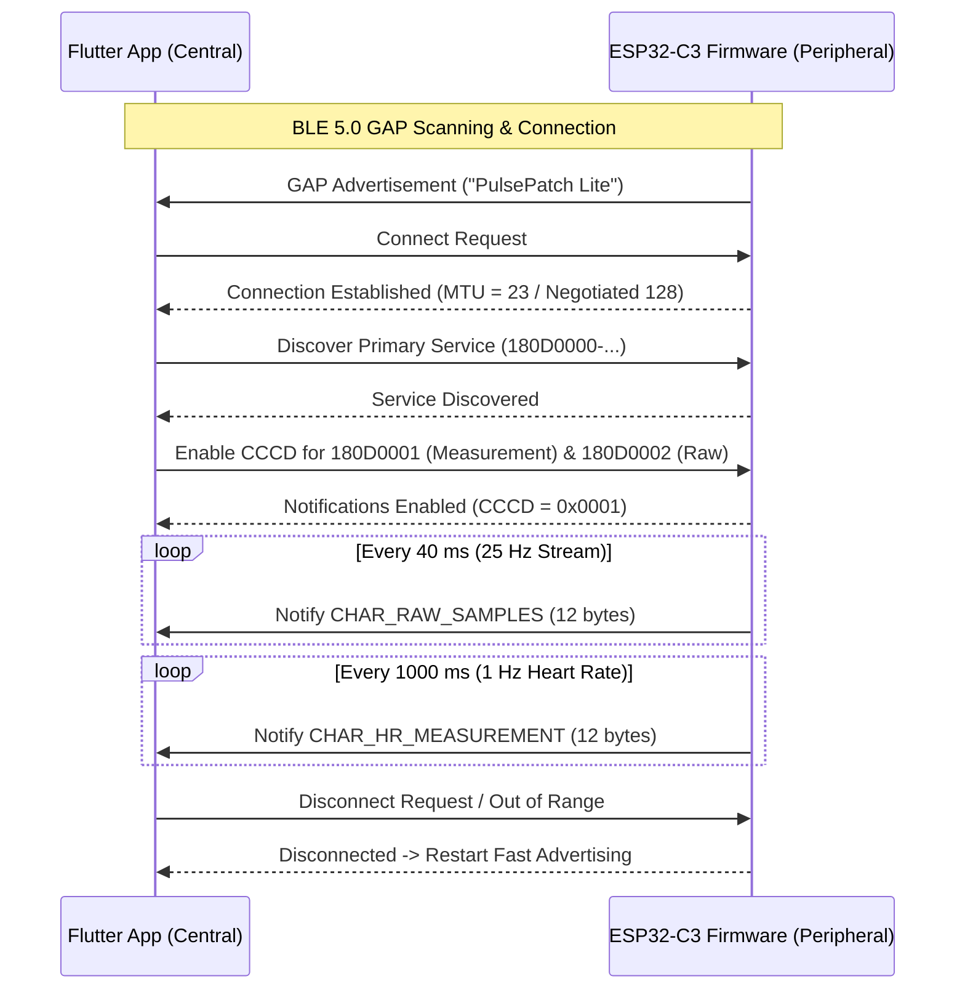

# PulsePatch Lite — BLE GATT Protocol Specification

**Document Identification:** DOC-BLE-PROTO-V2.1  
**App Version:** 2.1.0  
**Firmware Version:** 2.0.0-esp32c3  
**Architecture:** Bluetooth Low Energy (BLE 5.0 Core Specification)  
**Byte Order:** Little-Endian (Standard BLE Architecture)  

---

## 1. Protocol Architecture & Advertising

PulsePatch Lite operates as a BLE GATT Peripheral (Server). The mobile application operates as a BLE Central (Client).

### 1.1 GAP Advertising Parameters

- **Device Name (Local Name):** `PulsePatch Lite`
- **Advertising Interval:** 100 ms (Fast connection mode for initial 60s, then 250 ms)
- **Primary Service Advertised:** `180D0000-7243-4E64-8843-50554C534531`
- **TX Power:** +3 dBm

---

## 2. GATT Profile Definition

### 2.1 Service Hierarchy

```
Service: PulsePatch Biomonitoring Service
├── UUID: 180D0000-7243-4E64-8843-50554C534531
│
├── Characteristic: Heart Rate & SpO2 Measurement
│   ├── UUID: 180D0001-7243-4E64-8843-50554C534531
│   ├── Properties: Read (0x02), Notify (0x10)
│   ├── Client Characteristic Configuration (CCCD): 0x2902
│   └── Payload Length: 12 Bytes fixed
│
├── Characteristic: Raw PPG Dual-Wavelength Samples
│   ├── UUID: 180D0002-7243-4E64-8843-50554C534531
│   ├── Properties: Read (0x02), Notify (0x10)
│   ├── Client Characteristic Configuration (CCCD): 0x2902
│   └── Payload Length: 12 Bytes fixed
│
└── Characteristic: Device Status, Commands & Battery
    ├── UUID: 180D0003-7243-4E64-8843-50554C534531
    ├── Properties: Read (0x02), Write (0x08), Notify (0x10)
    └── Payload Length: 4 to 8 Bytes variable
```

---

## 3. Byte-Level Packet Specification

### 3.1 Heart Rate & SpO2 Measurement Packet (`CHAR_HR_MEASUREMENT`)

- **Characteristic UUID:** `180D0001-7243-4E64-8843-50554C534531`
- **Transmission Rate:** 1 Hz during active measurement
- **Length:** 12 Bytes
- **Endianness:** Little-Endian

| Offset (Hex) | Offset (Dec) | Size | Data Type | Field | Description / Value Range |
|---|---|---|---|---|---|
| `0x00` | 0 | 1 | `uint8_t` | `version` | Protocol version = `0x01` |
| `0x01` | 1 | 1 | `uint8_t` | `flags` | Bit 0: Optical contact (`1`=on skin, `0`=off skin)<br>Bit 1: Motion artifact flag (`1`=motion, `0`=still)<br>Bits 2–7: Reserved (must be `0`) |
| `0x02..0x03` | 2–3 | 2 | `uint16_t` | `bpmTimes10` | Heart rate in units of 0.1 BPM (e.g. `742` = 74.2 BPM).<br>`0xFFFF` indicates calculating or invalid reading. |
| `0x04` | 4 | 1 | `uint8_t` | `sqi` | Signal Quality Index (0 to 100 %). Minimum 60 required for session recording. |
| `0x05..0x08` | 5–8 | 4 | `uint32_t` | `timestampMs`| Device internal hardware clock time in milliseconds since boot (`millis()`). Used for jitter compensation. |
| `0x09..0x0A` | 9–10 | 2 | `uint16_t` | `sequenceNumber` | Monotonic incrementing packet index (0 to 65535, wraps to 0). Central uses this to detect dropped packets. |
| `0x0B` | 11 | 1 | `uint8_t` | `spo2` | Blood oxygen saturation percentage (70 to 100 %). `0` indicates calculating/uncalibrated. |

#### Example Binary Hex Dump:
```
01 01 E6 02 55 20 4E 00 00 12 00 62
```
**Parsing:**
- `01`: Version 1
- `01`: Contact detected (`0b00000001`), no motion
- `E6 02`: `0x02E6` = 742 -> **74.2 BPM**
- `55`: 85% SQI (High quality)
- `20 4E 00 00`: `0x00004E20` = 20,000 ms since boot
- `12 00`: Sequence number 18
- `62`: `0x62` = **98% SpO2**

---

### 3.2 Raw Dual-Wavelength Photoplethysmogram (`CHAR_RAW_SAMPLES`)

- **Characteristic UUID:** `180D0002-7243-4E64-8843-50554C534531`
- **Transmission Rate:** 25 Hz (Sample every 40 ms)
- **Length:** 12 Bytes
- **Endianness:** Little-Endian

| Offset (Hex) | Offset (Dec) | Size | Data Type | Field | Description / Value Range |
|---|---|---|---|---|---|
| `0x00..0x03` | 0–3 | 4 | `uint32_t` | `timestampMs` | Hardware timestamp (`millis()`). |
| `0x04..0x07` | 4–7 | 4 | `uint32_t` | `irSample` | 18-bit ADC raw infrared photodiode counts (0 to 262,143). |
| `0x08..0x0B` | 8–11 | 4 | `uint32_t` | `redSample` | 18-bit ADC raw red photodiode counts (0 to 262,143). |

#### Mathematical Ratio-of-Ratios SpO2 Processing:
The Central app extracts the AC and DC components from the dual-wavelength stream:
$$\text{Ratio } R = \frac{(AC_{\text{red}} / DC_{\text{red}})}{(AC_{\text{ir}} / DC_{\text{ir}})}$$
$$\text{SpO}_2 = 110 - 25 \times R$$

---

## 4. Connection State Machine & Flow Control



---

## 5. Security & MTU Considerations

1. **LE 1M PHY:** Compatible with Android 8.0+ devices.
2. **MTU Size:** Default ATT MTU of 23 is sufficient for 12-byte payloads, but firmware requests MTU exchange up to 128 bytes for batch streaming efficiency.
3. **Reconnection:** Central automatically attempts background reconnection when RSSI > -85 dBm.
